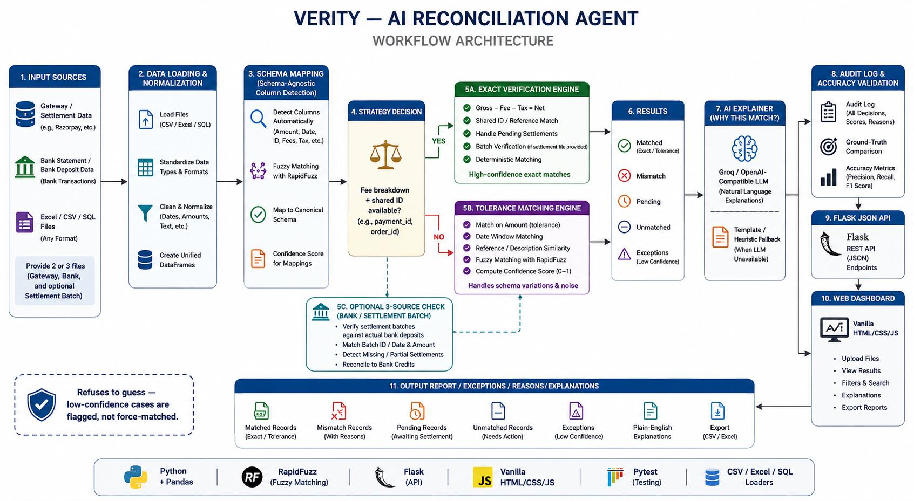

# Verity — AI Reconciliation Agent
### *"Match. Flag. Explain."*
### Razorpay Buildathon 2026 — Track 4: AI Finance Controller

**🔴 Live demo:** [verity-ai-reconciliation.onrender.com](https://verity-ai-reconciliation.onrender.com)

Built by Deeksha K P · MITE Mangalore

---

## 1. The problem

Every time a customer pays through a gateway like Razorpay, at least two independent
records get created: the gateway's own settlement report ("we processed this payment,
took this fee, are sending you this net amount"), and the actual bank deposit. These
records are supposed to agree — but fees get deducted, settlement is delayed, reference
formats differ across systems, and sometimes an entry is simply missing or duplicated.

Someone has to check: **do these records actually represent the same transaction, and
does the money add up?** Today this is done largely by hand in spreadsheets — slow,
repetitive, and error-prone. Razorpay's own framing of this track states it plainly:
*"verification capacity, not generation speed, is the bottleneck."*

## 2. What Verity does

Given any two (or three) financial data files, Verity automatically:

1. **Figures out the columns itself** — no manual configuration, works on a schema
   it's never seen before
2. **Decides which reconciliation technique the data actually supports** — exact
   arithmetic verification where a real fee breakdown exists, tolerance-based matching
   where it doesn't
3. **Refuses to guess** — anything it isn't confident about gets flagged with a
   specific, auditable reason instead of being force-matched
4. **Explains every flag in plain English**, using a real LLM call (with a template
   fallback if no API key is set, so it never breaks)
5. **Verifies settlement batches against actual bank deposits** when a third file is
   provided — genuine multi-source reconciliation, not a bigger single algorithm
6. **Proves its own accuracy** against known-correct answers instead of just claiming
   a number

## 3. Architecture



**Two engines, picked automatically — never manually:**

| | Tolerance matching (`matcher.py`) | Exact verification (`auto_reconciler.py`) |
|---|---|---|
| Used when | No shared ID, no fee breakdown | A real fee breakdown + shared ID exist |
| How it decides | Confidence score: amount + date + reference similarity | Real arithmetic: `Gross − Fee − Tax = Net`, to the rupee |
| Real-world analogy | Matching a bank statement with no internal reference | Verifying a payment gateway's own settlement report |

The decision (`choose_strategy()`) inspects the actual columns provided — it never
assumes. If a bank statement is also supplied, exact verification chains into a second
check: does each settlement **batch** total match what actually hit the bank? (Real
gateways pay out many transactions as one lump sum — Razorpay's `settlement_id`,
Stripe's `automatic_payout_id` — so this is the standard two-stage pattern real
finance-ops reconciliation actually uses, not a single bigger three-way algorithm.)

## 4. Tech stack

| Layer | Tool | Why |
|---|---|---|
| Data handling | Python, Pandas | Cleaning and joining tabular sources |
| Fuzzy matching | RapidFuzz | Fast, reliable string similarity |
| AI reasoning | Groq (Llama, free tier), OpenAI-compatible | Schema mapping + plain-English explanations |
| Backend | Flask | Exposes the logic as a JSON API |
| Frontend | Vanilla HTML/CSS/JS | Full design control, no framework ceiling |
| Data sources | CSV, Excel (openpyxl), SQL (SQLAlchemy) | Proven — not just claimed — to feed the same logic |
| Testing | Pytest, 55 tests | See §6 |

Every LLM call has a heuristic/template fallback, so the app runs and demos correctly
with zero API key — you just get richer explanations when one is connected.

## 5. Project structure

```
verity/
├── README.md
├── requirements.txt
├── Procfile                       ← Render deployment
├── .env.example                   ← copy to .env, add your Groq key
├── server.py                      ← Flask backend + API (primary)
├── app.py                         ← Streamlit dashboard (secondary, faster to deploy)
├── src/
│   ├── config.py                    Tunable thresholds, documented
│   ├── logger.py                    Shared logging setup
│   ├── llm_client.py                 Picks Groq or OpenAI from env vars
│   ├── generate_data.py              2-file demo data + ground truth
│   ├── generate_multi_source_data.py 3-file demo data + ground truth
│   ├── schema_mapper.py              Schema-agnostic column detection
│   ├── matcher.py                    Tolerance-matching engine
│   ├── auto_reconciler.py            Strategy picker + exact verification + batches
│   ├── three_way_reconciler.py       Exact-verification engine (3-sheet Excel input)
│   ├── explainer.py                  LLM explanations for both engines
│   ├── evaluate.py                   Ground-truth accuracy validation for both engines
│   ├── data_loaders.py               CSV/Excel/SQL loaders
│   └── audit_log.py                  Audit trail read/write for both engines
├── tests/                          55 tests across 6 files — see §6
├── web/                            HTML/CSS/JS frontend
└── data/                           Demo CSVs + ground truth labels
```

## 6. Testing — 55 tests, several written after real bugs were found

| File | Tests | Covers |
|---|---|---|
| `test_reconciliation.py` | 18 | Tolerance-matching engine |
| `test_auto_reconciler.py` | 21 | Strategy selection, multi-source batches, pending-status handling, audit logging |
| `test_three_way_reconciler.py` | 9 | Exact-verification engine (3-sheet Excel) |
| `test_explainer_exact.py` | 4 | Exact-engine explanations are genuinely distinct from raw reasons |
| `test_data_loaders.py` | 3 | CSV/Excel/SQL all feed the same engine |

Run with `pytest tests/ -v`.

**Real bugs found while testing against authentic data** (not just written up after
the fact — each has a regression test now):

1. **Unix epoch timestamps misread as nanoseconds.** Real gateway timestamps
   (`created_at: 1754006400`) are epoch *seconds*; pandas' default parser reads a raw
   integer as epoch *nanoseconds*, producing a date in 1970 and a false ~20,000-day
   gap. Fixed with explicit epoch-range detection.
2. **A column named `billed_cents` wasn't recognized as an amount field** — the
   keyword heuristic only knew common names like "amount"/"paid". Broadened the list.
3. **The "Amount" exception filter silently matched zero results** for the exact
   engine, because it searched for the word "mismatch" — language the tolerance
   engine uses, but the exact engine never says (it says "shortfall"/"excess"
   instead). Fixed by filtering on the actual status field, not fragile text-matching.
4. **"Explanation" was silently a copy of "Reason"** for every exact-verification
   exception — the AI was never actually called on that path. Added a genuine second
   explainer with its own prompt.
5. **The exact-verification path never wrote to the audit log at all.** Uploading a
   3-file dataset (triggering exact verification) meant "Ask Verity" always read an
   empty log, confidently answering "no entries exist" even though the Exceptions tab
   correctly showed real results moments earlier. Fixed with a dedicated audit-log
   writer for the exact engine's record shape.
6. **The generalized exact engine had no "pending settlement" handling at all** —
   a status inherited conceptually from the original 3-sheet engine but never ported
   over when generalized. Rows still awaiting settlement were silently run through
   math checks instead of being recognized as "not failed, just not settled yet."
   Found live against a real user-uploaded dataset with 10 genuinely pending rows
   that were being reported as zero.

## 7. Running it locally

```bash
pip install -r requirements.txt
cp .env.example .env        # then paste your free Groq key (console.groq.com)
python src/generate_data.py
python src/generate_multi_source_data.py
python server.py            # open http://localhost:5000
```

Click **"Run Reconciliation"** with nothing uploaded to see the default multi-source
demo (real Razorpay schema, 3 deliberately planted issues). Upload your own CSVs on
the Upload Data page to see schema-agnostic matching on an unfamiliar format —
`data/sample_unfamiliar_payments.csv` / `settlements.csv` work well for this.

## 8. Known limitations

- **No multi-currency/forex support** — international transactions would need
  currency + exchange-rate normalization first.
- **No refund/chargeback handling in the tolerance-matching engine** (the exact
  engine does handle this — see "prior-period deduction" — but only when a fee
  breakdown is available).
- **Multi-source batch verification needs a genuine settlement/batch ID and fee
  structure already present** — it correctly falls back to 2-source matching
  otherwise, rather than inventing a batch concept where none exists.
- **Not scale-tested** past a few hundred records; the matching loop is O(n×m).
- **SQL loading is implemented and tested** (`src/data_loaders.py`,
  `tests/test_data_loaders.py`) but **not wired into the web UI** — a
  connection-string input needs real credential-handling care that deserved more
  time than the deadline allowed.
- **Thresholds are hand-picked**, not tuned against real historical data.

## 9. Deploying

**Render.com (free tier)** — what this repo is actually deployed on:
1. Push to a public GitHub repo.
2. render.com → New → Web Service → connect the repo.
3. Build command: `pip install -r requirements.txt`
4. Start command: `python server.py`
5. Add environment variable `GROQ_API_KEY` in Render's dashboard.
6. Deploy. Free tier sleeps after inactivity — visit the URL once before a demo to
   wake it up.

**Streamlit Community Cloud** is a faster alternative for `app.py` specifically —
see Streamlit's own deploy docs; the same `GROQ_API_KEY` goes in "Secrets" instead.
