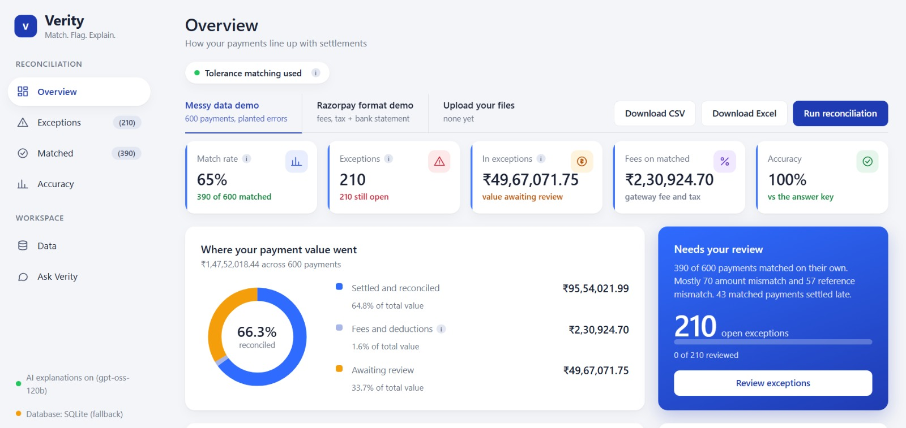

# Verity: AI Reconciliation Agent
### *"Match. Flag. Explain."*
Razorpay Buildathon 2026, Track 4: AI Finance Controller

**🔴 [Live demo](https://verity-ai-reconciliation.onrender.com)** *(free tier sleeps; open once and wait a few seconds)*

## In short
Verity matches payments to bank settlements, flags anything it is unsure about with a clear reason, and explains each flag in plain English. The AI only explains; it never decides a match.

- **471/471** payments classified correctly on a test with real Olist order amounts (an Excel-style exact lookup got 454/471)
- **First-pass matching drops from about 26 minutes by hand to a few seconds**
- **100%** on an adversarial test set (600 records) after fixing 24 false matches
- **87 passing tests**, deployed live on Render
- **Stack:** Python, Flask, Pandas, RapidFuzz, PostgreSQL (Supabase), Groq

Built by [Deeksha K P](https://www.linkedin.com/in/deeksha-k-p-392773293/) 

---


*Demo on a deliberately messy set: 600 payments with 210 planted errors (typos, duplicates, late settlements, fee deviations). Verity auto-matched the 390 clean ones, flagged all 210 problem cases with a reason, and scored 100% against the answer key. The 65% match rate is expected on this set, not a weakness.*

## 1. The problem

Every time a customer pays through a gateway like Razorpay, at least two independent
records get created: the gateway's own settlement report ("we processed this payment,
took this fee, are sending you this net amount"), and the actual bank deposit. These
records are supposed to agree, but fees get deducted, settlement is delayed, reference
formats differ across systems, and sometimes an entry is simply missing or duplicated.

Someone has to check: **do these records represent the same transaction, and does the
money add up?** Today this is done largely by hand in spreadsheets: slow, repetitive and
error-prone. Razorpay's own framing of this track says it plainly:
*"verification capacity, not generation speed, is the bottleneck."*

## 2. What Verity does

Given two (or three) financial files, Verity:

1. **Figures out the columns itself.** No manual configuration; it works on a schema it has never seen.
2. **Picks the reconciliation method the data supports.** Exact arithmetic where a real fee breakdown
   exists, confidence-scored matching where it doesn't.
3. **Refuses to guess.** Anything it isn't sure about goes to an Exceptions list with a specific,
   auditable reason instead of being force-matched.
4. **Explains every flag in plain English.** The LLM writes explanations only; it never decides a match.
   There is a template fallback, so the app runs with no API key.
5. **Verifies settlement batches against bank deposits** when a bank statement is provided.
6. **Supports a review workflow.** Each exception can be marked open, resolved or escalated with a
   required reason, a reviewer name and a history timeline. Reviews are saved in a database.
7. **Exports an Excel report** (summary, exceptions with review status, matched items).
8. **Proves its own accuracy** against known-correct answers instead of just claiming a number.

### The dashboard
- **Overview:** match rate, exceptions, value in exceptions, a donut of where the payment value went
  (settled, fees, awaiting review), settlement speed, match confidence, recent reviews and a
  "ready to close this period?" check.
- **Exceptions:** filter by type, status and sort order; open a row to see why it was flagged, the
  closest settlement, and record a decision. "Save and go to next open" works down the queue.
- **Matched, Accuracy, Data, Ask Verity:** matched items (with late settlements flagged), measured
  accuracy against labels, your own file upload, and questions answered from the audit log.

## 3. Measured results

Razorpay's bar for this track: *"Throughput plus measured accuracy plus an honest exception list."*
Everything below is reproducible: `python src/evaluate.py`, `python src/benchmark.py 1000 10000`.

**Accuracy: two synthetic test sets.** The *demo* set is generated by `generate_data.py`, written
alongside the matcher, so a perfect score there proves little. The *hard* set
(`generate_hard_data.py`) is deliberately adversarial: reference typos, reformatted references, decoy
settlements with near-identical amounts, same-amount collisions, late and very late settlements, tiny
fee anomalies, duplicates. **Trust the hard set.**

| | Demo set (150) | Hard set (600) |
|---|---|---|
| Before (first version) | 91.3% accuracy, 97.4% precision, 91.7% recall (3 false auto-matches) | 79.2% accuracy, 90.5% precision, 75.9% recall (31 false auto-matches, 94 wrongly flagged) |
| After identity-first matching | 100% / 100% / 100% | 96.0% accuracy, 94.2% precision, 100% recall (24 false auto-matches) |
| After fee-consistency check | 100% / 100% / 100% | **100% / 100% / 100%** (0 false auto-matches, 0 wrongly flagged) |

The 24 mistakes before the last step were all `small_fee_anomaly` (an extra 0.1–0.4% deduction that hides
inside the fee tolerance). The fee-consistency check learns the batch's typical fee rate from the matched
pairs and flags pairs that deviate. It only runs when the fee rate is consistent; otherwise it is skipped.

**Test on real payment amounts (partly real data).** 500 payments from the public Olist e-commerce
dataset (real order IDs, amounts and dates), with *simulated* settlements (2% fee, delays, typos,
duplicates, missing and wrong amounts). Verity classified 471 of 471 scored payments correctly (100%),
against 96.4% for an exact-match lookup like the one done by hand in Excel. The whole gap is reference
typos: the lookup recovered 1 of 18, Verity all 18. Reproduce with `make_real_test.py` and
`src/score_real_test.py`. Honest caveat: the settlement side is simulated, and the errors were injected by
me, so this is evidence of behaviour on known failure types, not of accuracy on real settlement files.

**Speed** (matcher only, one core):

| Payments | Before | After |
|---|---|---|
| 150 | 10.4 s (14.5 records/sec) | 0.02 s |
| 1,000 | not run | 0.13 s |
| 10,000 | not run | 3.1 s |
| 50,000 | not run | 67 s |

`python src/time_study.py payments.csv settlements.csv` times any two files. On the 500-payment Olist
test Verity took about 2 s. A first-pass Excel `XLOOKUP` check of 100 rows took 5 min 14 s by hand, and
it catches no duplicates, late settlements or reference typos. Speed is not the main advantage on small
files: the value is in what the lookup misses and in the reason given for every exception.

**Threshold sensitivity** (`evaluate.py` prints it): precision and recall are flat from 80 to 90 and fall
off past 92.5, so the confidence threshold is a safety margin. The reference-identity check and the
amount tolerance do the real work.

## 4. Architecture


**Two engines, picked automatically, never manually:**

| | Tolerance matching (`matcher.py`) | Exact verification (`auto_reconciler.py`) |
|---|---|---|
| Used when | No shared ID, no fee breakdown | A real fee breakdown + shared ID exist |
| How it decides | Confidence score: amount + date + reference similarity | Real arithmetic: `Gross − Fee − Tax = Net`, to the paisa |
| Real-world analogy | Matching a bank statement with no internal reference | Verifying a payment gateway's own settlement report |

`choose_strategy()` inspects the actual columns provided; it never assumes. If a bank statement is also
supplied, exact verification chains into a second check: does each settlement **batch** total match what
actually hit the bank? (Gateways pay out many transactions as one lump sum, Razorpay's `settlement_id` or
Stripe's `automatic_payout_id`, so this two-stage pattern is the one real finance-ops reconciliation uses.)

**Matching in the tolerance engine:** the reference decides which settlement a payment is compared with
(exact normalised lookup first, fuzzy fallback only if there is no hit). A pair whose references disagree
is never auto-matched. Late settlements within 30 days are matched and flagged; beyond that they stay
exceptions. Refund and chargeback-style rows always go to review.

## 5. Tech stack

| Layer | Tool | Why |
|---|---|---|
| Data handling | Python, Pandas | Cleaning and joining tabular sources |
| Money | `Decimal`, integer paise | Exact arithmetic, no floating-point drift |
| Fuzzy matching | RapidFuzz | Fast, reliable string similarity |
| AI | Groq (Llama / gpt-oss, free tier), OpenAI-compatible | Schema mapping and plain-English explanations only |
| Backend | Flask | JSON API |
| Frontend | Vanilla HTML/CSS/JS | Full design control, no framework |
| Database | SQLAlchemy Core: SQLite locally, PostgreSQL (Supabase) in production | Review state and audit history |
| Export | openpyxl | Excel report |
| Testing | Pytest, 88 tests | See §7 |

Every LLM call has a heuristic/template fallback, so the app runs and demos correctly with no API key.
Explanations are capped at the top 20 exceptions per run (`EXPLAIN_LLM_LIMIT`); the rest use templates.

## 6. Project structure

```
verity/
├── README.md
├── requirements.txt
├── Procfile                       ← Render deployment
├── .env.example                   ← copy to .env, add your keys
├── server.py                      ← Flask backend + API
├── make_real_test.py              ← builds the Olist-based test files
├── Verity_Architecture_Design.png ← architecture diagram
├── src/
│   ├── config.py                    Tunable thresholds, documented
│   ├── logger.py                    Shared logging setup
│   ├── llm_client.py                 Picks Groq or OpenAI from env vars
│   ├── money.py                      Decimal helpers (exact money)
│   ├── generate_data.py              2-file demo data + ground truth
│   ├── generate_multi_source_data.py 3-file demo data + ground truth
│   ├── generate_hard_data.py         Adversarial test set (independent of the matcher)
│   ├── benchmark.py                  Reproducible speed numbers
│   ├── time_study.py                 Time Verity on any two CSVs
│   ├── score_real_test.py            Score Verity vs an exact lookup on an answer key
│   ├── schema_mapper.py              Schema-agnostic column detection
│   ├── matcher.py                    Tolerance-matching engine
│   ├── auto_reconciler.py            Strategy picker + exact verification + batches
│   ├── three_way_reconciler.py       Exact-verification engine (3-sheet Excel input)
│   ├── explainer.py                  LLM explanations for both engines
│   ├── exception_store.py            Review workflow storage (SQLite / PostgreSQL)
│   ├── excel_export.py               Excel report builder
│   ├── evaluate.py                   Accuracy validation + threshold sweep
│   ├── data_loaders.py               CSV/Excel/SQL loaders
│   └── audit_log.py                  Audit trail read/write for both engines
├── tests/                          88 tests across 9 files, see §7
├── web/                            HTML/CSS/JS frontend
└── data/                           Demo CSVs + ground truth labels
```

## 7. Testing — 88 tests, several written after real bugs were found

| File | Tests | Covers |
|---|---|---|
| `test_reconciliation.py` | 18 | Tolerance-matching engine |
| `test_auto_reconciler.py` | 21 | Strategy selection, batches, pending status, audit logging |
| `test_three_way_reconciler.py` | 9 | Exact-verification engine (3-sheet Excel) |
| `test_explainer_exact.py` | 4 | Exact-engine explanations are distinct from raw reasons |
| `test_data_loaders.py` | 3 | CSV/Excel/SQL all feed the same engine |
| `test_identity_and_scale.py` | 13 | Decoys, collisions, typo/format refs, late settlements, fee check, hard-set accuracy floor, speed |
| `test_money.py` | 7 | Exact Decimal arithmetic, no float drift |
| `test_exception_store.py` | 9 | Review workflow, history, database fallback (1 PostgreSQL test runs only if `VERITY_TEST_PG_URL` is set) |
| `test_export_and_refunds.py` | 4 | Excel export contents, refund handling |

Run with `python -m pytest tests -q` (expect 87 passed, 1 skipped).

## 8. Where I got stuck, and how I got out

| What blocked me | How I found the cause | What I did |
|---|---|---|
| **Matching took 10.4 s for 150 records**, so the app felt frozen | Profiled it: 56% of the time went to re-parsing dates inside a nested loop | Rewrote it vectorised, first proving it made *identical* decisions on all 150 records. About 500x faster; 10,000 records now take 3 s |
| **A wrong settlement was auto-matched** (similar amount, different reference), and it used up the settlement that belonged to a later payment | Listed every wrong decision on the labelled set instead of looking at one accuracy number | Identity-first matching: the reference chooses which settlement to compare, and a pair whose references disagree is never auto-matched |
| **"Delayed" settlements scored 47%** | Saw that my data generator and my matcher disagreed about what "delayed" means | Made it a design decision: a late settlement with a matching reference is the same transaction, so it is matched and flagged (up to 30 days) |
| **Tiny fee deviations slipped through** (an extra 0.1–0.4% looked like a normal fee) | The hard test set showed 24 false matches, all of one type | Added a fee-consistency check that learns the typical fee rate and flags deviations. It is skipped when the file has mixed fee rates |
| **Real gateway files broke my assumptions** | Ran Razorpay- and Stripe-style files, not just my own data | Fixed epoch-second timestamps being read as nanoseconds, a `billed_cents` column not being seen as an amount, pending settlements being run through math checks, and the exact path never writing an audit log. Each has a regression test |
| **The test suite took 125 s** | Saw that the tests were making real LLM API calls | Blanked the API keys in `tests/conftest.py`. The suite now runs in about 4 s |
| **A run took far too long with the AI on** | Counted 186 separate LLM explanation calls for one run | Cap AI explanations at the top 20 exceptions by size; the rest use templates |
| **The live site showed "Unexpected token '<' … is not valid JSON"** | The database connection failed and the server returned an HTML error page. The cause was an `@` in my database password, which made the host name parse wrongly | The server now falls back to SQLite and returns JSON errors, the sidebar shows which database is live, and I changed to a password without special characters |
| **Float noise in the Excel report** (a gap of 5793.020000000004) | Opened the downloaded report and checked the numbers | Money is handled as exact `Decimal` / integer paise, and values are rounded to 2 places on export |
| **I could not get real paired payment and settlement data** | Searched for public datasets; settlement files are private company records | Tested on 500 real Olist payment amounts with simulated settlements, and said so plainly |

## 9. Running it locally

```bash
python -m venv venv
venv\Scripts\activate           # Windows (use: source venv/bin/activate on macOS/Linux)
pip install -r requirements.txt
copy .env.example .env          # then paste your free Groq key (console.groq.com)
python src/generate_data.py
python src/generate_multi_source_data.py
python server.py                # open http://localhost:5000
```

Pick a dataset on the Overview page and click **Run reconciliation**. To use your own files, choose
"Upload your files" and add a payments CSV and a settlements CSV on the Data page (a bank statement is
optional). `data/sample_unfamiliar_payments.csv` and `settlements.csv` work well for an unfamiliar format.

## 10. Known limitations

- **No real production data.** Both test sets are generated, and the Olist test uses real payment amounts
  with simulated settlements. The numbers show behaviour on known failure types, not accuracy on real
  settlement files.
- **One-to-one matching and one fee rate per file.** A single payout covering many payments is only
  handled by the exact engine (when a batch ID exists), and the fee check is skipped on files that mix
  payment methods or fee tiers.
- **No login.** The reviewer name is typed, not verified, and the "reason required" rule is enforced in
  the browser only. Keep real data off the public demo.
- **Scale.** 10,000 payments take about 3 s and 50,000 about 67 s, because unmatched references fall back
  to fuzzy search. Not tested beyond 50,000.

## 11. Deploying

**Render.com (free tier)**, which is what this repo is deployed on:
1. Push to a public GitHub repo (never push `.env`, `venv/` or `logs/*.db`).
2. render.com → New → Web Service → connect the repo.
3. Build command: `pip install -r requirements.txt`
4. Start command: `python server.py`
5. Environment variables:
   - `GROQ_API_KEY` for AI explanations (optional; the app works without it)
   - `VERITY_DB_URL` for a shared database (optional; use the Supabase **Session pooler** string, and
     URL-encode special characters in the password, or use an alphanumeric one)
6. Deploy. Visit the URL once before a demo to wake it up.
